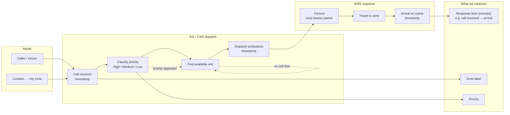
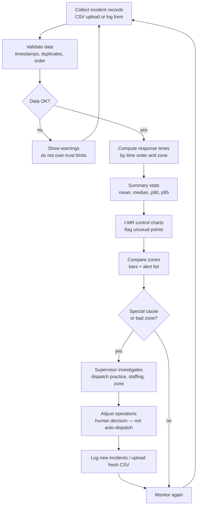

# Literature Review: EMS Response-Time Monitoring and Quality Control

**Team:** Chiblings  
**Project:** Prompt #2 — Health Systems, Emergency Response  
**Purpose:** Summarize what others already do about slow ambulances and zone-by-zone response times, and how that helps our hackathon tool.

---

## In simple words (read this first)

Imagine you call for help when someone is hurt. You want the ambulance to come **fast**. A **supervisor** (the grown-up in charge of dispatch) watches many calls every day. If they only look at **one big average** for the whole month, they might miss **bad days** or **one part of the city** where ambulances are always late.

Our project builds a **computer helper** that:

- Reads a list of past calls (like a spreadsheet).
- Figures out **how many minutes** each ambulance took.
- Draws **math pictures** (charts) that show when times look **unusual**.
- Compares **zones** (neighborhood areas) so the supervisor knows **where** to look.

Other people — cities, companies, and researchers — already built big systems for this. We are building a **small, clear, student version** with the same ideas: **zones**, **timestamps**, **percentiles**, and **statistical process control (SPC)**.

---

## Abbreviations (plain English)

| Abbreviation | Stands for | Simple meaning |
|--------------|------------|----------------|
| **EMS** | Emergency Medical Services | Ambulance and emergency medical help |
| **911** | Emergency phone number (US) | Where people call for help |
| **CAD** | Computer-Aided Dispatch | The computer system dispatchers use to send ambulances |
| **SPC** | Statistical Process Control | Using math charts to see if a process is “ behaving normally ” or “ something weird happened ” |
| **I-MR** | Individuals and Moving Range | One type of SPC chart when you measure one thing at a time (one response time after another) |
| **UCL / LCL** | Upper / Lower Control Limit | Lines on a chart; points outside them may mean a **special problem**, not normal day-to-day noise |
| **NFPA** | National Fire Protection Association | A group that writes safety standards, including how fast fire/EMS should respond |
| **NFPA 1710** | A specific NFPA standard | Rules about response times (often “90% of calls should meet a time goal”) |
| **NEMSIS** | National EMS Information System | A national way to store and share EMS call data in the US |
| **OCU** | Online Compliance Utility | FirstWatch’s web tool to check if ambulances met contract time rules |
| **KPI** | Key Performance Indicator | A number leaders watch to see if things are going well |
| **90th percentile (p90)** | — | 90% of calls were faster than this number; the slowest 10% were worse |
| **95th percentile (p95)** | — | Same idea for the slowest 5% |
| **ALS / BLS** | Advanced / Basic Life Support | How much medical skill is on the ambulance |
| **API** | Application Programming Interface | How our Python backend sends results to a website |
| **FastAPI** | — | A Python toolkit to build that backend (what we chose in SPEC) |

---

## What the literature shows (four themes)

### 1. Zone-by-zone monitoring and “late run” alerts

**What others did:** Commercial tools (especially **FirstWatch**) pull **CAD** timestamps and compare each call to **rules** — often **by geographic zone** (beat, sub-zone, urban vs rural). When a call is **late**, the system can **alert** supervisors and support **contract** reporting between a city and an ambulance company [1]–[3].

**Relation to our work:** Our user is an **EMS dispatch supervisor** watching the **five NYC boroughs**. We do not connect to real CAD; we use **built-in scenarios**, **CSV upload**, and the **CLI/API**. The *idea* is the same: **per-incident times**, **grouped by borough**, **flag unstable or incapable processes**.

**How we use it:**

- Borough names in `data/` match real reporting (Queens, Brooklyn, …).
- In [`demo/README.md`](demo/README.md), the live dashboard shows **I-MR**, **p90**, and **Cpk vs 8 min** per borough — Six Sigma process view, not only “late yes/no.”
- [`README.md`](README.md) cites FirstWatch-style tools as industry context (not as our code source).

---

### 2. Percentiles and averages — why monthly averages lie

**What others did:** Guides and agency reports stress that **average** response time hides **slow tail** calls. **Fractile** metrics (especially **90th percentile**) and **95th percentile** are common in EMS contracts and public reporting [4]–[6]. **NFPA 1710** frames goals as “**not less than 90%** of calls” within a time limit, not “average equals X” [7]–[9].

**Relation to our work:** Our SPEC already asks for **mean, median, standard deviation, p90, and p95**. That matches how real agencies talk about performance and directly answers the hackathon prompt (“monthly averages miss fatal outliers”).

**How we can use it:**

- In the dashboard, show **both** mean and p90 with tiles and histograms: “Average looks okay, but p90 shows the slow tail.”
- The **High Delay** scenario (`highDelayAlex_2026_24000_synthetic.csv`) raises **p90** and **geo mean** citywide — a story judges recognize from [4] and [10].
- **Cpk** against the 8-minute USL makes the NFPA-style target explicit in `app/qc.py` (see `SPEC.md`).

---

### 3. Statistical process control (SPC) on ambulance response times

**What others did:** Research explicitly applied **control charts** (e.g. **X-bar and S**, **CUSUM**, **p-chart**) to **ambulance response time** data, finding high variability and periods of stability vs instability [11]. That is closer to our **I-MR** core than dashboard-only products.

**Relation to our work:** Our graded core is **SPC (I-MR)** with a **known-answer check** in SPEC. We are aligning with peer-reviewed-style QA, not inventing a new statistic.

**How we can use it:**

- Cite [11] in README or `data/README.md` as motivation for **control charts in EMS**.
- Keep **one tested function** in `app/qc.py` for limits; mention that industry often uses multiple chart types, but we scope to **I-MR** for the hackathon (see SPEC out-of-scope).

---

### 4. Public reporting, data standards, and audits

**What others did:** **NEMSIS** provides **public dashboards** on aggregated EMS data; officials note that deep analysis needs **case-level** records [12]. Counties publish **zone compliance graphs** processed through tools like FirstWatch OCU [10]. **Audits** of 911 centers emphasize **data quality**, **missing timestamps**, and **routine monitoring** — not one summary number [13].

**Relation to our work:** We invent **synthetic case-level CSVs** with a **codebook** (CONTRACT H-02). Our **validation warnings** (bad timestamps, duplicates, too few points) mirror audit themes without using real PHI (protected health information).

**How we can use it:**

- `data/README.md`: describe columns in **NEMSIS-like** language (call time, dispatch, on-scene) without claiming NEMSIS certification.
- Document **response time definition** (e.g. call received → arrival) and stick to it — audits show definitions matter [4], [9].
- Reference [12] to explain why we built a **tool** on **uploaded rows**, not only a national aggregate dashboard.

---

## Commercial and government examples (quick map)

| Source type | Example | Similar to our… |
|-------------|---------|-----------------|
| Product | FirstWatch OCU [2], triggers [1] | Zone compliance, alerts, supervisor workflow |
| Product | ZOLL operational dashboards [5], [6] | Response summaries, maps/filters by priority |
| Research | UGPTI SPC report [11] | **I-MR / control limits** on response times |
| Government | DC FEMS evaluation plan [9], measures page [8] | Timestamp stages, NFPA-style 90% goals |
| Government | Multnomah ambulance report [10] | Zone graphs, compliance rates |
| Government | DeKalb E911 audit [13] | Why monitoring and data checks matter |
| Standards / data | NEMSIS dashboards [12], performance guide [14] | National EMS data context |
| Practice article | PSC Group analysis [4] | Outliers, fractiles, definition of “response time” |

We are **not** rebuilding FirstWatch or NEMSIS. We are a **transparent, reproducible teaching tool**: Python **FastAPI**, tested **I-MR**, three demo datasets, public GitHub — as required by the hackathon [15], [16].

---

## How this supports our CONTRACT tasks (without extra scope)

| Task | Literature helps us… |
|------|----------------------|
| **H-02** Data | Shape CSVs and codebook like [10]; plant zone delays like contract reports |
| **H-03** `app/qc.py` | Justify I-MR via [11]; known-answer check stays in SPEC |
| **H-04–H-05** Demo | Interpret charts like [4] (mean vs p90); borough comparison like [10] — see [`demo/README.md`](demo/README.md) |
| **H-07** README | Short “Related work” paragraph pointing to [2], [11], [9] |
| **H-06** Deploy | Same as any web tool; no citation required |

---

## References (IEEE-style)

[1] FirstWatch, “Triggers,” *FirstWatch.net*. [Online]. Available: https://firstwatch.net/triggers/. [Accessed: Oct. 16, 2026].

[2] FirstWatch, “Online Compliance Utility (OCU),” *FirstWatch.net*. [Online]. Available: https://firstwatch.net/what-we-do/enhancement-modules/online-compliance-utility/. [Accessed: Oct. 16, 2026].

[3] FirstWatch, “Response Time Performance, by Zone,” Stout Solutions, LLC, 2009. [Online]. Available: https://firstwatch.net/wp-content/themes/firstwatch/files/Law%20Enforcement/LE_Response%20Time%20Performance-by%20Beat%20or%20Zone_20090113.pdf. [Accessed: Oct. 16, 2026].

[4] The PSC Group, “How To Analyze EMS Response Times For Better Public Safety,” *thepscgroup.net*. [Online]. Available: https://thepscgroup.net/how-to-analyze-ems-response-times-for-better-public-safety/. [Accessed: Oct. 16, 2026].

[5] ZOLL Data Systems, “Operational Dashboards Turn EMS Data into Actionable Insight,” *ZOLL Data Blog*. [Online]. Available: https://www.zolldata.com/blog/operational-dashboards-turn-ems-data-into-actionable-insight. [Accessed: Oct. 16, 2026].

[6] ZOLL Data Systems, “Using Statistical Analysis to Drive EMS Performance Improvement,” *ZOLL Data Blog*. [Online]. Available: https://www.zolldata.com/blog/using-statistical-analysis-to-drive-ems-performance-improvement. [Accessed: Oct. 16, 2026].

[7] NFPA, “NFPA 1710 Fact Sheet,” National Fire Protection Association. [Online]. Available: https://www.nfpa.org/-/media/project/storefront/catalog/files/code-or-topic-fact-sheets/nfpa_1710_fact_sheet.pdf. [Accessed: Oct. 16, 2026].

[8] Fire and Emergency Medical Services Department (FEMS), “Response Time Measures,” District of Columbia. [Online]. Available: https://fems.dc.gov/page/response-time-measures. [Accessed: Oct. 16, 2026].

[9] FEMS, “Response Time Evaluation Plan,” District of Columbia, 2015. [Online]. Available: https://fems.dc.gov/sites/default/files/dc/sites/fems/Response%20Time%20Evaluation%20Plan.pdf. [Accessed: Oct. 16, 2026].

[10] Multnomah County, “911 Ambulance Contract Response Time Performance Report: Oct 2018 – June 2024,” Emergency Medical Services program. [Online]. Available: https://multco.us/file/911_ambulance_contract_response_time_performance_report:_oct_2018_-_june_2024/download. [Accessed: Oct. 16, 2026].

[11] Upper Great Plains Transportation Institute (UGPTI), “Quality Assurance of Emergency Management Operation Processes through Statistical Process Control,” *UGPTI Report*, North Dakota State Univ. [Online]. Available: https://www.ugpti.org/resources/reports/downloads/dp-283.pdf. [Accessed: Oct. 16, 2026].

[12] NEMSIS Technical Assistance Center, “NEMSIS Public Dashboards,” *nemsis.org*. [Online]. Available: https://nemsis.org/view-reports/public-reports/version-3-public-dashboards/. [Accessed: Oct. 16, 2026].

[13] DeKalb County Office of Internal Audit, “Audit of E911 Call Response Times,” Report No. IA-2024-242-PS, 2024. [Online]. Available: https://dekalbcountyga.gov/sites/default/files/2026-04/Final%20Audit%20of%20E911%20Call%20Response%20Times%20-%20%20Report%20No.%20IA-2024-242-PS.pdf. [Accessed: Oct. 16, 2026].

[14] NEMSIS Technical Assistance Center, *NEMSIS V3 Performance Measure Service Technical Guide*, Jul. 2024. [Online]. Available: https://nemsis.org/wp-content/uploads/2024/07/NEMSIS-V3-Performance-Measure-Service-Technical-Guide.pdf. [Accessed: Oct. 16, 2026].

[15] Cornell Six Sigma Hackathon, “Six Sigma Hackathon,” *Devpost*. [Online]. Available: https://six-sigma-hackathon.devpost.com/. [Accessed: Oct. 16, 2026].

[16] T. Fraser, *sixsigmahackathon* (source repository), GitHub. [Online]. Available: https://github.com/timothyfraser/sixsigmahackathon. [Accessed: Oct. 16, 2026].

---

## One-paragraph “Related work” you can paste into README later

Emergency medical services agencies commonly monitor ambulance **response times** using **computer-aided dispatch** data, often reporting compliance **by zone** and using **90th-percentile** metrics because **averages hide slow outliers** [4], [10]. Commercial platforms such as **FirstWatch** provide near–real-time **compliance** workflows for supervisors and contractors [2], [3], while vendors such as **ZOLL** emphasize operational **dashboards** and drill-down by priority and geography [5]. Research has applied **statistical process control** charts directly to ambulance response-time processes [11]. Our project contributes a **small, open, Python/FastAPI** prototype for the Cornell hackathon that combines **I-MR control charts**, **percentile summaries**, and **zone comparisons** on **synthetic incident-level data**, with validated statistics tested against a known example in `SPEC.md` [15], [16].

---

## Process map (Prompt #2 — Emergency Response)

**In simple words:** A person calls **911**. People at the **dispatch center** answer, pick **how urgent** the call is, and send an **ambulance**. The ambulance drives to the **zone** (area of the city) where help is needed. The **supervisor** watches whether each trip took too long. If something looks wrong, they **investigate** (maybe move ambulances to a busy zone) and **check again** later. Our tool helps on the **watch and investigate** steps — not on driving the ambulance.

This map combines ideas from **NFPA / FEMS** time stages [8], [9], **CAD** logging [2], **zone compliance** reporting [10], and **SPC** for ongoing stability [11].

### Map A — Emergency response (field + dispatch)

What happens from call to on-scene arrival. Rework loops (dashed) are common in real systems when a unit is unavailable or a call is upgraded.

**Plain reading (left to right):** Call → classify → assign unit → dispatch → travel → arrive. Each arrow is a step where the **CAD** usually saves a **timestamp**. We turn those into **response time** and **zone** for charts.

---

### Map B — Supervisor quality loop (where our tool sits)

What the **EMS dispatch supervisor** does with logged incidents — aligned with FirstWatch-style **monitoring** [2], [3], percentile views [4], [10], and **I-MR** analysis [11].

**Plain reading:** Put data in → check it → math and charts → supervisor decides if a **zone** or **day** looks broken → people fix things in the real world → new data → repeat. The loop matches **define–measure–analyze–improve–control** without building forbidden scope (no live 911 hookup, no auto-dispatch — see `SPEC.md` §9).

---

### SIPOC (one-page view)

| **S** — Suppliers | **I** — Inputs | **P** — Process | **O** — Outputs | **C** — Customers |
|-------------------|----------------|-----------------|-----------------|-------------------|
| Callers, 911 center staff, EMS crews, CAD system | Incident ID, zone, priority, call/dispatch/arrival timestamps | Answer → classify → dispatch → respond → record → analyze → review → act (if needed) | Response times, control charts, zone summaries, alerts, interpretation text | EMS dispatch **supervisor**; indirectly, patients and city leaders who need reliable response |

---

### How this map connects to our hackathon deliverables

| Process step | Our artifact |
|--------------|--------------|
| Record incidents | `data/*.csv`, logging form in app |
| Validate & compute | `app/qc.py` |
| Show charts & alerts | FastAPI + dashboard (`app/`) |
| Prove statistics | `tests/` + SPEC known-answer |
| Explain the process | This `LR.md` map + [`demo/README.md`](demo/README.md) on the Connect URL (H-05) |
